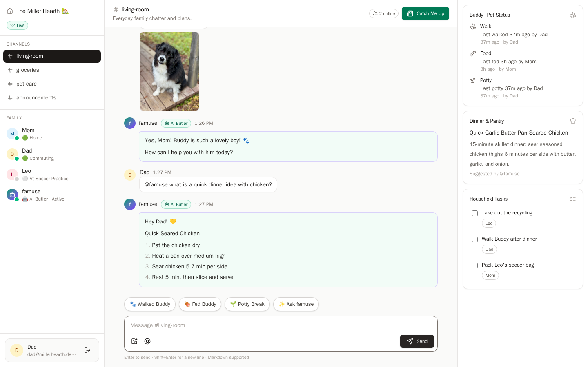
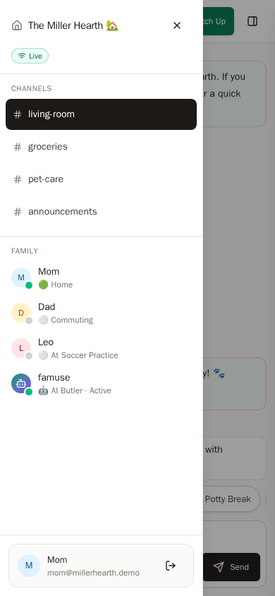

# famuse 🏡

**famuse** (Family + Muse — made for family *use*) is an open-source, edge-native, AI-first private family collaboration hub. Each family channel is a real-time room backed by its own hibernating Cloudflare Durable Object, and **@famuse** — a polite, proactive household butler — answers through the **Meta Model API** (Muse Spark).

Built for the [Meta Global AI Developer Hackathon](https://dev.meta.ai/events/global-hackathon).

**Live demo:** https://famuse.a10n.workers.dev — open it and choose **Continue as Dad** (no signup needed). Demo data resets hourly.

**Demo video:** [famuse — When Muse Joins Your Family](https://youtu.be/3SXRY-c3ze8) (2 min)

<a href="https://youtu.be/3SXRY-c3ze8"></a>





## Features

- **Real-time family rooms** — `#living-room`, `#groceries`, `#pet-care`, `#announcements`, each backed by its own Durable Object with WebSocket hibernation, presence, and typing indicators.
- **@famuse AI butler** — Mention `@famuse` for dinner ideas, pet status, or household help. One click on **Catch Me Up** summarizes anything you missed.
- **Plugin system** — Family domains hook into prompts, room state, and quick-action chips through one `FamilyPlugin` interface. Ships with **Pet Care**: Buddy the Golden Retriever's walks, meals, and potty breaks with overdue alerts.
- **Household context drawer** — Live pet status, the pinned @famuse recipe, and checkable household tasks.
- **Photo sharing** — Image uploads stored in Cloudflare R2, rendered inline, click to enlarge in a fullscreen viewer.
- **Mobile-ready** — Slide-in navigation and household drawers, touch-sized targets, safe-area-aware composer.
- **Family auth** — Better Auth (managed by Void) with email/password, a seeded roster (Admins: Mom & Dad, Member: Leo), and one-click demo sign-in.
- **Offline-capable demo** — Without a Meta API key, a built-in local assistant answers from real room data so every flow still works.

## Quickstart

Prerequisites: Node.js 22+ and [pnpm](https://pnpm.io/).

```sh
pnpm install
pnpm exec void db seed   # reset local D1 and load the Miller household
pnpm run dev             # or: nr dev
```

Open `http://localhost:5173` and choose **Continue as Dad** (Mom and Leo work too — open a second browser to see real-time sync).

### AI setup (optional, recommended)

Create a `.env` file at the project root, create a key in the [Meta Model API dashboard](https://dev.meta.ai), and add it:

```ini
MODEL_API_KEY=LLM_xxx
```

Without a key, famuse answers with its built-in local assistant. With a key, replies come from `muse-spark-1.3` via `https://api.meta.ai/v1/chat/completions` (both configurable, see `env.ts`).

### Demo script (60 seconds)

1. Sign in as **Dad** — the `#living-room` history already shows the dinner thread.
2. Ask `@famuse any lunch ideas with eggs and cheese?` and watch the butler reply.
3. Tap the **🐾 Walked Buddy** chip — the walk is logged and the pet card updates.
4. Press **Catch Me Up** for an instant digest.
5. Attach a photo with the image button, click it to enlarge, then check a task in the right drawer.

## Architecture

```
[ Browser: React + Tailwind + Void typed WS client ]
│
├── HTTP / Auth / REST ──► [ Hono API on Cloudflare Workers ] ──► [ D1 ]
│                                 └── Better Auth (email/password)
├── WebSocket ───────────► [ FamilyRoomDO per channel ] ──► [ DO storage ]
│                                 ├── recent-50 message cache
│                                 ├── plugin pipeline (Pet Care)
│                                 └── Meta Model API client ──► [ api.meta.ai ]
└── Uploads ─────────────► [ Worker ] ──► [ R2 ] ──► served via /api/files/*
```

Key design decisions:

- **One Durable Object per channel** via Void's typed `defineRoom` rooms (`routes/rooms/[channel].ws.ts`), with SQLite-backed storage and framework-managed hibernation. D1 keeps long-term history; the DO keeps the hot cache and AI context.
- **Pet state is household-wide**: plugin mutations land in DO storage for instant broadcast and are mirrored to D1 (`pet_events`) so every channel agrees.
- **Uploads go through the Worker** into R2 (`void/storage`) instead of presigned URLs, keeping the demo self-contained with no extra credentials.
- **AI answers never go silent**: Meta Model API first, deterministic local assistant on failure or missing key.

## Project structure

```
routes/
  rooms/[channel].ws.ts      FamilyRoomDO: typed events, presence, AI triggers
  api/channels/...           Message history (D1)
  api/uploads.ts             Image upload → R2
  api/files/[...key].ts      Authenticated file serving
  api/tasks/...              Household tasks
  api/pet/status.ts          Household-wide Buddy summary
  api/demo/ensure-household.ts  Idempotent demo bootstrap
durable state                Per-channel DO storage (recent cache, plugin keys)
db/schema.ts                 households, members, messages, pet_events, tasks
src/shared/                  channels, zod WS events, demo accounts, formatting
src/server/muse/             persona, Meta Model API client, local assistant
src/server/plugins/          FamilyPlugin contract, registry, pet-care
src/server/room-pipeline.ts  persist → broadcast → plugins → @famuse
src/client/                  hooks, shadcn-style UI, 3-column hub
pages/                       loader (auth + household snapshot) + app shell
```

## Configuration

| Variable | Default | Purpose |
| --- | --- | --- |
| `MODEL_API_KEY` | — | Meta Model API key (optional) |
| `MODEL_API_BASE_URL` | `https://api.meta.ai/v1` | OpenAI-compatible base URL |
| `MODEL_API_MODEL` | `muse-spark-1.3` | Chat model for @famuse |
| `MODEL_API_TIMEOUT_MS` | `30000` | Outbound AI request budget |

Local values live in a single root `.env` file (Void supports only `.env` —
`.env.example`, `.env.local`, and other variants stop the dev server with an
error, so the full template is inlined here instead of a separate file).
See `env.ts` for the schema. Production secrets are set with `void secret put`.

```ini
# Meta Model API key from https://dev.meta.ai (dashboard).
# Optional: without a key, famuse answers with its built-in local
# assistant so the demo keeps working offline.
MODEL_API_KEY=

# OpenAI-compatible base URL for the Meta Model API.
MODEL_API_BASE_URL=https://api.meta.ai/v1

# Chat model for the famuse butler.
MODEL_API_MODEL=muse-spark-1.3

# Outbound request budget for AI replies inside a room (milliseconds).
MODEL_API_TIMEOUT_MS=30000
```

Useful commands:

```sh
pnpm run dev            # local dev server (listens on 0.0.0.0)
pnpm exec void db seed  # re-seed the demo household
pnpm exec void db studio  # inspect local D1
pnpm run build          # production build
pnpm run test:e2e       # Playwright smoke tests
```

## Testing

A small Playwright smoke suite covers demo sign-in, real-time messaging
between two members, household task toggling, the ask-famuse chip, and
the phone layout (slide-in navigation/household drawers, mobile
composer):

```sh
pnpm exec playwright install --with-deps chromium  # first time only
pnpm run test:e2e
```

See [docs/testing.md](docs/testing.md) for the testing strategy, CI setup,
and troubleshooting.

## Deploy

famuse deploys to Cloudflare Workers with `void deploy`, plus automatic
deploys from CI on every push to `main`. See
[docs/deploy.md](docs/deploy.md) for the full procedure: API token setup,
first deploy, secret management, and narrowing the CI token after
bootstrap.

```sh
pnpm exec void deploy --platform cloudflare   # first deploy from your machine
```

## License

MIT — see [LICENSE](LICENSE).
